# E2E permutation tree

Playwright BDD tree for **test-loco-webapp**. Each leaf is an independent,
parallel-safe test with unique data (`beforeEach`) and API cleanup (`afterEach`
via the `testRun` fixture).

**Run:** `devenv shell -- moon run e2e:e2e`

## Test conventions

| Concern | Pattern |
|---------|---------|
| Unique data | `uniqueUser` fixture per leaf (`e2e-w{worker}-{testId}-{uuid}@e2e.test.local`) |
| Seeding | Nested `beforeEach` on branches that need preconditions |
| Cleanup | `testRun` fixture deletes workspaces/pages via API in `afterEach` |
| Tokens | SQLite helper reads verify/reset tokens from `e2e.sqlite` |
| Parallelism | `fullyParallel: true`, `workers: 1` (SQLite pool); isolated emails prevent collisions |
| Form POST | `waitForFormPost(page)` before asserting on soft-navigated UI |
| Persistence | Soft SPA mutations do **not** refresh cached queries in-place — tests **reload** the target URL after POST to assert server state |
| Editor nav | Prefer `page.goto` to editor URL after create/redirect (Solid soft nav can leave stale route mounted) |
| Page Model | One class per route under `pages/`; each exposes `goto()` + `expectLoaded()` and action helpers |
| Shared helpers | `crates/web/e2e/support/ui-helpers.ts` (login, reload/persistence utilities) |

## Coverage checklist

Legend: **UI** = user clicks/types in browser; **reload** = full navigation after POST to verify persistence.

### Auth (`tests/auth.tree.spec.ts`)

- [x] Register / new email → login banner
- [x] Register / duplicate email → 409 UI + recovery links
- [x] Login / valid credentials → workspace shell (account menu + home copy)
- [x] Login / invalid password → friendly error
- [x] Login / unknown email → friendly error
- [x] Login / post-register banner (`?registered=1`)
- [x] Forgot / existing account → success message
- [x] Forgot / unknown email → same success (no leak)
- [x] Reset / valid token → password updated + login
- [x] Reset / missing token → alert + disabled submit
- [x] Reset / invalid token → no success message
- [x] Verify / valid token → verified message
- [x] Verify / invalid token → failure alert

### Navigation (`tests/navigation.tree.spec.ts`)

- [x] Home / guest → Get started + Log in
- [x] Home / authenticated → Open app
- [x] Protected route → redirect to login
- [x] Sidebar / Home, Settings, Members, New page links
- [x] Logout → login page (profile menu → Log out)

### Workspace (`tests/workspace.tree.spec.ts`)

- [x] First login → Personal workspace shell
- [x] Settings → rename → Saved (UI + inline success)
- [x] Members → invite → Member invited (UI)
- [x] Switcher → second workspace

### Page editor (`tests/page-editor.tree.spec.ts`)

#### Page lifecycle

- [x] Create page → editor (UI create + hard load editor)
- [x] Rename title → persists after reload (UI save + reload)

#### Blocks

- [x] Add block / empty state → persists after reload (UI **Add your first block**)
- [x] Add block / toolbar → persists after reload (UI **Add block**)
- [x] Edit block text → persists after reload (UI save + reload)
- [x] Delete block → gone after reload (UI delete + reload)

#### Comments

- [x] Open panel → add comment via UI → persists after reload
- [x] Delete comment via UI → gone after reload

#### Shares

- [x] Open panel → add share via UI → persists after reload
- [x] Remove share via UI → gone after reload

### Known product gaps (documented, not blocking e2e)

- Soft form mutations do not revalidate live query UI without full reload (blocks/comments/shares lists stay stale until navigation)
- Create-page soft redirect can leave `/p/new` mounted; tests hard-load editor URL

### Out of scope (no UI yet)

- [ ] Magic link auth
- [ ] Resend verification email
- [ ] Block type change / reorder
- [ ] Sidebar collapse persistence
- [ ] 404 page content

## Mermaid diagram

```mermaid
flowchart TD
  APP[Application E2E]

  APP --> AUTH[Auth]
  APP --> NAV[Navigation]
  APP --> WS[Workspace]
  APP --> PAGE[Page editor]

  AUTH --> REG[Register]
  AUTH --> LOGIN[Login]
  AUTH --> FORGOT[Forgot password]
  AUTH --> RESET[Reset password]
  AUTH --> VERIFY[Email verify]

  REG --> REG_OK[New email → login banner]
  REG --> REG_DUP[Duplicate → email_taken UI]

  LOGIN --> LOGIN_OK[Valid → workspace shell]
  LOGIN --> LOGIN_BAD[Wrong password]
  LOGIN --> LOGIN_UNK[Unknown email]
  LOGIN --> LOGIN_BANNER[registered=1 banner]

  FORGOT --> FORGOT_OK[Known email → sent message]
  FORGOT --> FORGOT_UNK[Unknown email → sent message]

  RESET --> RESET_OK[Valid token → updated]
  RESET --> RESET_NO[Missing token → alert]
  RESET --> RESET_BAD[Invalid token → no success]

  VERIFY --> VERIFY_OK[Valid token → verified]
  VERIFY --> VERIFY_BAD[Invalid token → alert]

  NAV --> NAV_GUEST[Guest home CTAs]
  NAV --> NAV_AUTH[Authed home Open app]
  NAV --> NAV_GUARD[Protected → login]
  NAV --> NAV_SIDEBAR[Sidebar links]
  NAV --> LOGOUT[Profile menu → login]

  WS --> WS_FIRST[First login Personal WS]
  WS --> WS_RENAME[Settings rename Saved]
  WS --> WS_MEMBERS[Invite member]
  WS --> WS_SWITCH[Switch workspace]

  PAGE --> PG_NEW[Create page]
  PAGE --> PG_TITLE[Rename title + reload]
  PAGE --> PG_BLOCK_ADD1[Add first block + reload]
  PAGE --> PG_BLOCK_ADD2[Add block toolbar + reload]
  PAGE --> PG_BLOCK_EDIT[Edit block + reload]
  PAGE --> PG_BLOCK_DEL[Delete block + reload]
  PAGE --> PG_COMMENT_ADD[Add comment UI + reload]
  PAGE --> PG_COMMENT_DEL[Delete comment UI + reload]
  PAGE --> PG_SHARE_ADD[Add share UI + reload]
  PAGE --> PG_SHARE_RM[Remove share UI + reload]
```

## Interaction loops (product map)

These are the user-facing loops the app supports today. E2E leaves above map 1:1 to UI steps unless noted.

| Area | Loop | UI entry | Assert persistence |
|------|------|----------|---------------------|
| Auth | Register → Login → Workspace | `/register`, `/login` | URL + shell copy |
| Auth | Forgot → Reset → Login | `/forgot-password`, `/reset-password` | success copy + workspace |
| Auth | Verify email | `/verify/:token` | verified alert |
| Nav | Guest home → Register/Login | `/` | link visibility |
| Nav | Authed home → Open app | `/` | link visibility |
| Nav | Guard protected routes | `/w/:id/settings` | redirect `/login` |
| Nav | Sidebar traverse | Home, Settings, Members, New page | URL + landmark |
| Nav | Logout | Account menu → Log out | `/login` |
| Workspace | First visit | login | Personal workspace shell |
| Workspace | Rename | Settings → Save | Saved (inline) |
| Workspace | Invite member | Members → Invite | Member invited (inline) |
| Workspace | Switch workspace | sidebar select | URL `/w/:other` |
| Page | Create | New page → Create page | editor title field |
| Page | Rename title | Save title | reload → input value |
| Block | Add (empty) | Add your first block | reload → Text field |
| Block | Add (toolbar) | Add block | reload → second Text field |
| Block | Edit | Save on block | reload → textarea value |
| Block | Delete | Delete on block | reload → empty state |
| Comment | Add | Comments → Post | reload → panel list |
| Comment | Delete | Delete on comment | reload → absent |
| Share | Add | Share → Add | reload → panel list |
| Share | Remove | Remove on share | reload → absent |
